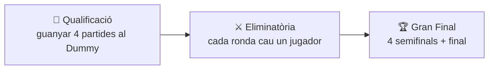

<div align="center">


<br>


**Programa una IA que lluiti per completar la venjança abans que les altres tres.**

[🎮 Jugar](#-com-fer-lo-funcionar) · [🧠 Crear el jugador](#-crear-el-teu-jugador) · [📤 Enviar](#-enviar-el-jugador) · [🏆 Fases](#-fases-de-la-competició)

</div>

---

## 🥷 De què va

La Beatrix Kiddo es desperta després de quatre anys en coma amb una sola idea al cap: venjar-se de la Brigada Assassina Mortal de les Víbores. Però al tauler hi ha **quatre còpies de la Beatrix**, cadascuna amb el seu exèrcit, i totes volen ser la primera a acabar la llista.

Tu programes el **cervell** d'una d'elles: cada ronda, el teu codi decideix què fa cada unitat.

<div align="center">

<br>
<sub>Il·lustració original d'un tauler (no és una captura real del visor)</sub>
</div>

### Els elements del joc

| | Element | Què fa |
|---|---|---|
| 🥷 | **Beatrix** | La teva unitat principal. Té vida, recull armes i mata enemics. |
| ⚔️ | **Guerrers** | Unitats secundàries: conquereixen cel·les, agafen medicines i maten guerrers rivals. |
| 👹 | **Enemics** | O-Ren, Vernita, Budd i Elle (4 còpies de cadascun, una per jugador). Persegueixen els teus guerrers. |
| 👑 | **Bill** | Únic i neutral. Persegueix la Beatrix més propera. |
| 🗡️ | **Armes** | Cal tenir l'arma correcta per matar cada enemic. |
| 💊 | **Medicines** | Recuperen vida de la Beatrix. |

| Enemic | Arma necessària |
|---|---|
| O-Ren Ishii | 🗡️ Katana |
| Vernita Green | 🔪 Ganivet |
| Budd | 🐍 Serp |
| Elle Driver | 🥄 Cullera |
| Bill | 📖 Llibre (i haver mort abans els 4 enemics!) |

### Com es puntua

Al final de cada ronda se sumen punts per:

- 💀 guerrers rivals morts (acumulat)
- 🟦 cel·les que posseeixes **en aquell moment** (si les perds, baixes!)
- 🎯 enemics morts per la teva Beatrix
- 🏅 bonus per matar en Bill

Guanya qui tingui més punts després de la ronda 299. Les constants són a `default.cnf`.

> [!TIP]
> Les ordres s'executen en ordre aleatori entre jugadors, però respectant el teu ordre intern. **Dona les ordres de més urgent a menys urgent.**

---

## 🚀 Com fer-lo funcionar

**Requisits:** `g++` recent, `make` i un navegador modern.

**1. Copia els objectes precompilats per al teu sistema**

<details open>
<summary>🐧 Linux x86-64 (el cas habitual)</summary>

```bash
cp AIDummy.o.Linux64 AIDummy.o
cp Board.o.Linux64 Board.o
```
</details>

<details>
<summary>🐧 Linux ARM64 (p. ex. WSL amb Snapdragon)</summary>

```bash
cp AIDummy.o.Linux-aarch64 AIDummy.o
cp Board.o.Linux-aarch64 Board.o
```
</details>

<details>
<summary>🍎 macOS</summary>

```bash
cp AIDummy.o.macOS-$(uname -m) AIDummy.o
cp Board.o.macOS-$(uname -m) Board.o
```
</details>

**2. Compila el joc i tots els jugadors**

```bash
make all
```

**3. Juga una partida**

```bash
./Game Demo Demo Demo Demo -s 30 -i default.cnf -o default.res
```

| Opció | Significat |
|---|---|
| `-s 30` | llavor aleatòria |
| `-i default.cnf` | configuració i tauler |
| `-o default.res` | fitxer de sortida |

**4. Mira-la**: obre `viewer.html` al navegador i carrega `default.res`.

```bash
./Game --help    # tots els paràmetres
./Game --list    # jugadors reconeguts
make clean       # neteja executable i objectes
```

---

## 🧠 Crear el teu jugador

1. Copia la plantilla: `cp AINull.cc AIHattori.cc`
2. Canvia el nom dins del fitxer:
   ```cpp
   #define PLAYER_NAME Hattori
   ```
   El nom ha de ser **únic, no ofensiu i de màxim 12 caràcters**.
3. Implementa el mètode `play()`, que es crida a cada ronda i dona les ordres.
4. **No toquis** `factory()` ni l'última línia del fitxer.

| Fitxer | Per a què serveix |
|---|---|
| `State.hh` | consultar l'estat del joc |
| `Action.hh` | donar ordres a les unitats |
| `Structs.hh` | estructures de dades útils |
| `Settings.hh` | paràmetres del joc |
| `Player.hh` | mètode `me()` |
| `Random.hh` | nombres aleatoris |
| `AIDemo.cc` | jugador d'exemple |

> [!NOTE]
> Tot el resum de l'API és a `api.pdf`.

---

## 📤 Enviar el jugador

Puja'l a **[games.jutge.org](https://games.jutge.org)** amb les teves credencials de Jutge.org.

> [!WARNING]
> L'enviament s'executa en un entorn segur amb aquestes restriccions:
> - Tot el codi en **un sol fitxer** (`AIHattori.cc`)
> - **Cap variable global** (usa atributs de la classe)
> - Només biblioteques estàndard; sense fitxers, threads ni crides a sistema
> - CPU i memòria **limitades**
> - **No escriguis** a `cout`, `cerr` ni llegeixis de `cin` (treu els `cerr` de depuració!)
> - Màxim **1000 ordres per ronda**
> - Un cop un jugador venç el Dummy, **el seu nom queda bloquejat**: per enviar més versions, canvia'l (p. ex. `Hattori2`)

---

## 🏆 Fases de la competició



| Fase | Què cal fer | Data |
|---|---|---|
| 🧪 **Qualificació** | Compilar, sobreviure a una partida amb 4 còpies de tu i **guanyar 4 partides contra 3 Dummies** | fins al **diumenge 6 des, 21:00** |
| ⚔️ **Eliminatòria** | Rondes de grups de 4; se salva qui supera 2 dels 3 rivals. Com més duris, més nota | des del **7 de desembre** |
| 🏆 **Gran Final** | Els 11 millors d'EDA (+5 d'Algorísmia). 4/3/2/1 punts per partida | **dimecres 16 des, 19:00**, Sala d'Actes de la FIB |

Qualificar-se garanteix **mínim 5 dels 10 punts**; no qualificar-se, 0. Recorda escollir el teu representant a la pestanya *Players* **abans** de l'eliminatòria.

---

## 💡 Consells ràpids

- 🎯 Primer, derrota el Dummy. Després ja pensaràs en els companys.
- 🧩 Comença amb estratègies simples, amb funcions auxiliars petites i provades.
- 🔁 Compila i prova sovint; guarda versions antigues i fes-les lluitar entre elles.
- ⏱️ Vigila el temps de CPU.
- 👀 Observa partides d'altres per aprendre'n les estratègies.
- ⏳ **No esperis a l'últim minut** per enviar: el servidor s'embussa.

---

## ⚖️ Normativa

> [!CAUTION]
> La pràctica és **individual**. No donis ni demanis codi, ni tan sols una versió antiga (només es poden compartir arxius objecte `.o`). **Està prohibit usar IA per implementar jugadors.** El plagi implica un **0 a tota l'assignatura** per a tots els involucrats, tant qui copia com qui facilita el codi.

Si hi ha cap diferència entre la documentació i el codi del joc, **preval el codi**.

<div align="center">
<sub>Fet amb ☕ per a l'assignatura EDA · FIB-UPC</sub>
</div>
