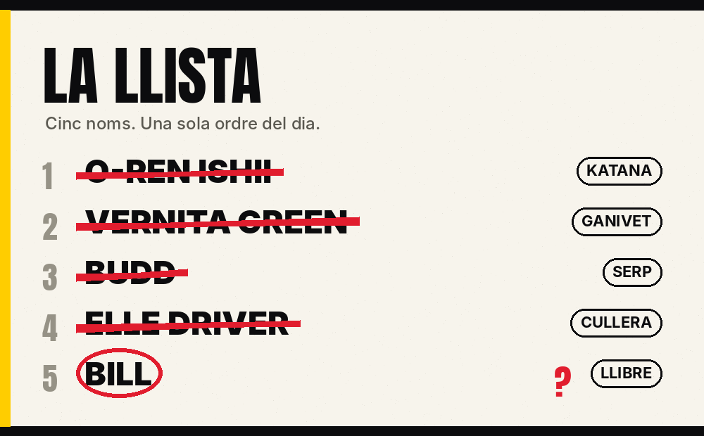

<div align="center">

</div>

<br>

<a id="intro"></a>


Notes meves del joc de EDA. Quatre còpies de la Beatrix al mateix tauler, 300 rondes, guanya qui acabi amb més punts. Jo només programo el cervell d'un jugador: el mètode `play()` decideix cada ronda què fa cada unitat meva.

<div align="center">

</div>

<br>

| | Què | Per què m'importa |
|---|---|---|
| 🥷 | **Beatrix** | L'única que recull armes i ataca enemics. Si mor, desapareix 5 rondes i torna amb la vida plena. |
| ⚔️ | **Guerrers** | Conquereixen cel·les i agafen medicines. Moren si toquen un enemic meu o en Bill. |
| 👹 | **Enemics** | 4 tipus, un per jugador. Només persegueixen els guerrers del seu jugador. |
| 👑 | **Bill** | Únic. Persegueix la Beatrix més propera i mai ataca guerrers. |
| 🗡️ | **Armes** | Només la meva Beatrix recull les meves. Una vegada recollides, no tornen. |
| 💊 | **Medicines** | Curen la Beatrix del jugador que l'agafa (guerrers inclosos). |

Arma que necessito per a cada enemic: O-Ren → katana, Vernita → ganivet, Budd → serp, Elle → cullera, Bill → llibre (i abans he d'haver matat els altres quatre).

### Punts

Es calculen a cada ronda i sumen: guerrers rivals morts, cel·les que tinc **en aquell moment**, enemics morts i bonus per Bill. Les constants són a `default.cnf`. Si perdo cel·les, la puntuació baixa.

### El que em puc oblidar

- Una unitat només fa **la primera ordre** que li dono cada ronda.
- Les ordres s'executen en ordre aleatori entre jugadors, però mantenint el meu ordre. Les urgents, primer.
- Cada moviment s'aplica sobre el tauler que han deixat els anteriors: una medicina pot desaparèixer abans que hi arribi.
- Un guerer que va cap a un enemic meu o cap a Bill **mor**. Només la Beatrix pot atacar-los.
- Els enemics i Bill només es mouen en rondes parelles (per defecte).
- Màxim 1000 ordres per ronda, o el programa s'avorta.

<a id="jugar"></a>


Necessito `g++`, `make` i un navegador.

**Primer cop**: copiar els objectes precompilats segons el sistema.

```bash
# Linux x86-64
cp AIDummy.o.Linux64 AIDummy.o && cp Board.o.Linux64 Board.o

# Linux ARM64
cp AIDummy.o.Linux-aarch64 AIDummy.o && cp Board.o.Linux-aarch64 Board.o

# macOS
cp AIDummy.o.macOS-$(uname -m) AIDummy.o && cp Board.o.macOS-$(uname -m) Board.o
```

**Compilar** el joc i tots els `AI*.cc`:

```bash
make all
```

**Jugar** una partida (seed 30, quatre Demo):

```bash
./Game Demo Demo Demo Demo -s 30 -i default.cnf -o default.res
```

**Veure-la**: obrir `viewer.html` al navegador i carregar `default.res`.

Altres comandes que em serviran:

```bash
./Game --help    # paràmetres
./Game --list    # noms de jugadors reconeguts
make clean       # tornar a començar
```

<a id="jugador"></a>


1. `cp AINull.cc AI<Nom>.cc`
2. Canviar `#define PLAYER_NAME Null` pel meu nom: únic, no ofensiu, màxim 12 caràcters.
3. Programar dins de `play()`. Aquest és el punt d'entrada; puc afegir atributs i mètodes auxiliars a la classe.
4. No tocar `factory()` ni l'última línia del fitxer.

Capçaleres que he de tenir a mà: `State.hh` (estat), `Action.hh` (ordres), `Structs.hh`, `Settings.hh` (paràmetres), `Player.hh` (`me()`), `Random.hh`. L'exemple és `AIDemo.cc` i el resum de l'API, `api.pdf`.

<a id="enviar"></a>


Es puja a [games.jutge.org](https://games.jutge.org) amb les credencials de Jutge.org. Revisar abans:

- [ ] Tot el codi està en un sol fitxer
- [ ] Cap variable global (tot dins de la classe)
- [ ] Només biblioteques estàndard, sense fitxers ni threads
- [ ] No escric a `cout`, `cerr` ni llegeixo de `cin` (he tret els `cerr` de depuració)
- [ ] El nom és únic i té com a màxim 12 caràcters
- [ ] Compila net i he fet una partida local contra Demo
- [ ] No emeto més de 1000 ordres per ronda
- [ ] Vaig bé de temps de CPU

Per qualificar-me haig de passar tres comprovacions: que compili, que una partida amb quatre còpies meves no avorti i que **guanyi quatre partides contra tres Dummies**. Un cop guanya el Dummy, el nom queda bloquejat: les versions noves necessiten un nom diferent (`Nom2`, `Nom3`...).

<a id="fases"></a>


| Quan | Què passa |
|---|---|
| Diumenge 6 des, 21:00 | Últim moment per tenir un jugador acceptat |
| Dilluns 7 des | Comença l'eliminatòria |
| Dimecres 16 des, 19:00 | Gran Final, Sala d'Actes de la FIB |

- Qualificat = mínim 5 punts de 10. No qualificat = 0 en aquesta part.
- Eliminatòria: es forma un grup de 4 a l'atzar cada ronda i se salva qui supera 2 dels 3 rivals. Com més tard m'eliminin, més nota.
- Els 11 últims d'EDA tenen la nota màxima i van a la final (amb 5 d'Algorísmia). Cada partida dona 4, 3, 2 o 1 punts.
- Cal triar el representant a la pestanya *Players* **abans** de l'inici. Puc canviar-lo i enviar versions noves mentre no estigui eliminat.
- Si el Dummy es queda curt, els professors el poden canviar sense avís.

<a id="normes"></a>


**Per on començar**

- Primer guanyar el Dummy. La resta, després.
- Estratègies simples i fàcils de depurar; funcions auxiliars petites i provades.
- Compilar i provar sovint. Guardar versions antigues i fer-les lluitar contra la nova.
- Mirar partides dels altres i aprendre'n.
- No esperar l'últim minut: el servidor s'embussa i pot ser massa tard.

**Normes**

La pràctica és individual. No donar ni demanar codi, ni una versió antiga (només es poden compartir `.o`). No es pot fer servir IA per implementar jugadors. Qualsevol plagi suposa un 0 a tota l'assignatura per a tots els implicats. Si el codi del joc i la documentació no coincideixen, preval el codi.
