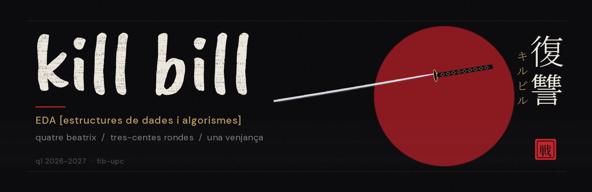
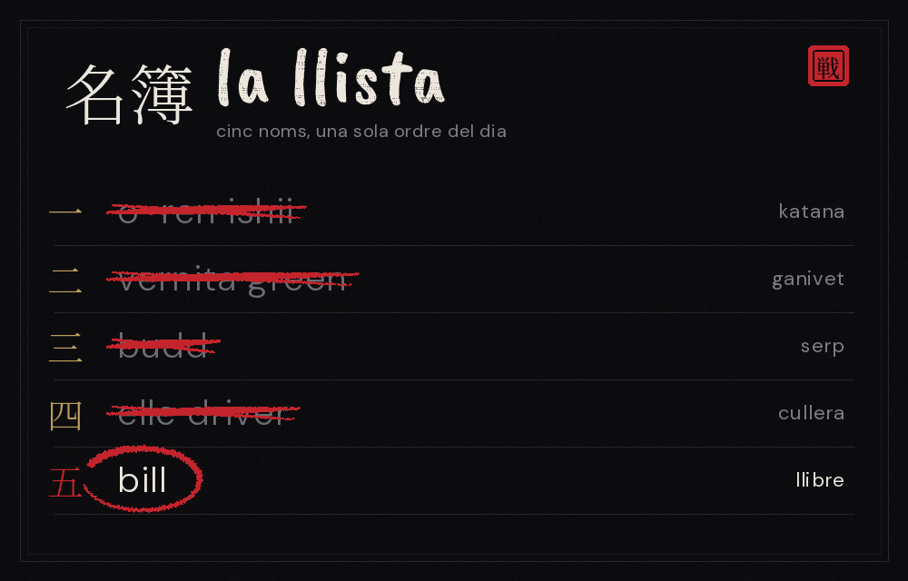
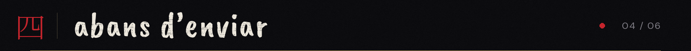
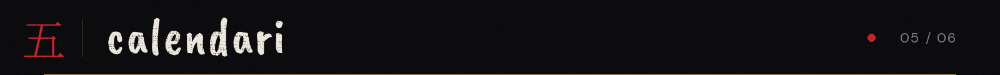
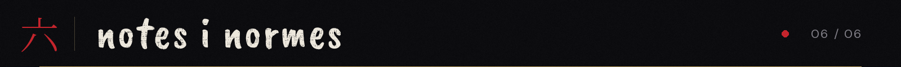

<div align="center">

</div>

<br>

<a id="intro"></a>


notes meves del joc de EDA [estructures de dades i algorismes]. quatre còpies de la beatrix al mateix tauler, 300 rondes, guanya qui acabi amb més punts. jo només programo el cervell d'un jugador: el mètode `play()` decideix cada ronda què fa cada unitat meva.

<div align="center">

</div>

<br>

| | què | per què m'importa |
|---|---|---|
| 🥷 | **beatrix** | l'única que recull armes i ataca enemics. si mor, desapareix 5 rondes i torna amb la vida plena. |
| ⚔️ | **guerrers** | conquereixen cel·les i agafen medicines. moren si toquen un enemic meu o en bill. |
| 👹 | **enemics** | 4 tipus, un per jugador. només persegueixen els guerrers del seu jugador. |
| 👑 | **bill** | únic. persegueix la beatrix més propera i mai ataca guerrers. |
| 🗡️ | **armes** | només la meva beatrix recull les meves. una vegada recollides, no tornen. |
| 💊 | **medicines** | curen la beatrix del jugador que l'agafa (guerrers inclosos). |

arma que necessito per a cada enemic: o-ren → katana, vernita → ganivet, budd → serp, elle → cullera, bill → llibre (i abans he d'haver matat els altres quatre).

### punts

es calculen a cada ronda i sumen: guerrers rivals morts, cel·les que tinc **en aquell moment**, enemics morts i bonus per bill. les constants són a `default.cnf`. si perdo cel·les, la puntuació baixa.

### el que em puc oblidar

- una unitat només fa **la primera ordre** que li dono cada ronda.
- les ordres s'executen en ordre aleatori entre jugadors, però mantenint el meu ordre. les urgents, primer.
- cada moviment s'aplica sobre el tauler que han deixat els anteriors: una medicina pot desaparèixer abans que hi arribi.
- un guerrer que va cap a un enemic meu o cap a bill **mor**. només la beatrix pot atacar-los.
- els enemics i bill només es mouen en rondes parelles (per defecte).
- màxim 1000 ordres per ronda, o el programa s'avorta.

<a id="jugar"></a>


necessito `g++`, `make` i un navegador.

**primer cop**: copiar els objectes precompilats segons el sistema.

```bash
# Linux x86-64
cp AIDummy.o.Linux64 AIDummy.o && cp Board.o.Linux64 Board.o

# Linux ARM64
cp AIDummy.o.Linux-aarch64 AIDummy.o && cp Board.o.Linux-aarch64 Board.o

# macOS
cp AIDummy.o.macOS-$(uname -m) AIDummy.o && cp Board.o.macOS-$(uname -m) Board.o
```

**compilar** el joc i tots els `AI*.cc`:

```bash
make all
```

**jugar** una partida (seed 30, quatre demo):

```bash
./Game Demo Demo Demo Demo -s 30 -i default.cnf -o default.res
```

**veure-la**: obrir `viewer.html` al navegador i carregar `default.res`.

altres comandes que em serviran:

```bash
./Game --help    # paràmetres
./Game --list    # noms de jugadors reconeguts
make clean       # tornar a començar
```

<a id="jugador"></a>


1. `cp AINull.cc AI<Nom>.cc`
2. canviar `#define PLAYER_NAME Null` pel meu nom: únic, no ofensiu, màxim 12 caràcters.
3. programar dins de `play()`. aquest és el punt d'entrada; puc afegir atributs i mètodes auxiliars a la classe.
4. no tocar `factory()` ni l'última línia del fitxer.

capçaleres que he de tenir a mà: `State.hh` (estat), `Action.hh` (ordres), `Structs.hh`, `Settings.hh` (paràmetres), `Player.hh` (`me()`), `Random.hh`. l'exemple és `AIDemo.cc` i el resum de l'api, `api.pdf`.

<a id="enviar"></a>


es puja a [games.jutge.org](https://games.jutge.org) amb les credencials de jutge.org. revisar abans:

- [ ] tot el codi està en un sol fitxer
- [ ] cap variable global (tot dins de la classe)
- [ ] només biblioteques estàndard, sense fitxers ni threads
- [ ] no escric a `cout`, `cerr` ni llegeixo de `cin` (he tret els `cerr` de depuració)
- [ ] el nom és únic i té com a màxim 12 caràcters
- [ ] compila net i he fet una partida local contra demo
- [ ] no emeto més de 1000 ordres per ronda
- [ ] vaig bé de temps de cpu

per qualificar-me haig de passar tres comprovacions: que compili, que una partida amb quatre còpies meves no avorti i que **guanyi quatre partides contra tres dummies**. un cop guanya el dummy, el nom queda bloquejat: les versions noves necessiten un nom diferent (`Nom2`, `Nom3`...).

<a id="fases"></a>


| quan | què passa |
|---|---|
| diumenge 6 des, 21:00 | últim moment per tenir un jugador acceptat |
| dilluns 7 des | comença l'eliminatòria |
| dimecres 16 des, 19:00 | gran final, sala d'actes de la fib |

- qualificat = mínim 5 punts de 10. no qualificat = 0 en aquesta part.
- eliminatòria: es forma un grup de 4 a l'atzar cada ronda i se salva qui supera 2 dels 3 rivals. com més tard m'eliminin, més nota.
- els 11 últims d'EDA tenen la nota màxima i van a la final (amb 5 d'algorísmia). cada partida dona 4, 3, 2 o 1 punts.
- cal triar el representant a la pestanya *players* **abans** de l'inici. puc canviar-lo i enviar versions noves mentre no estigui eliminat.
- si el dummy es queda curt, els professors el poden canviar sense avís.

<a id="normes"></a>


**per on començar**

- primer guanyar el dummy. la resta, després.
- estratègies simples i fàcils de depurar; funcions auxiliars petites i provades.
- compilar i provar sovint. guardar versions antigues i fer-les lluitar contra la nova.
- mirar partides dels altres i aprendre'n.
- no esperar l'últim minut: el servidor s'embussa i pot ser massa tard.

**normes**

la pràctica és individual. no donar ni demanar codi, ni una versió antiga (només es poden compartir `.o`). no es pot fer servir ia per implementar jugadors. qualsevol plagi suposa un 0 a tota l'assignatura per a tots els implicats. si el codi del joc i la documentació no coincideixen, preval el codi.
